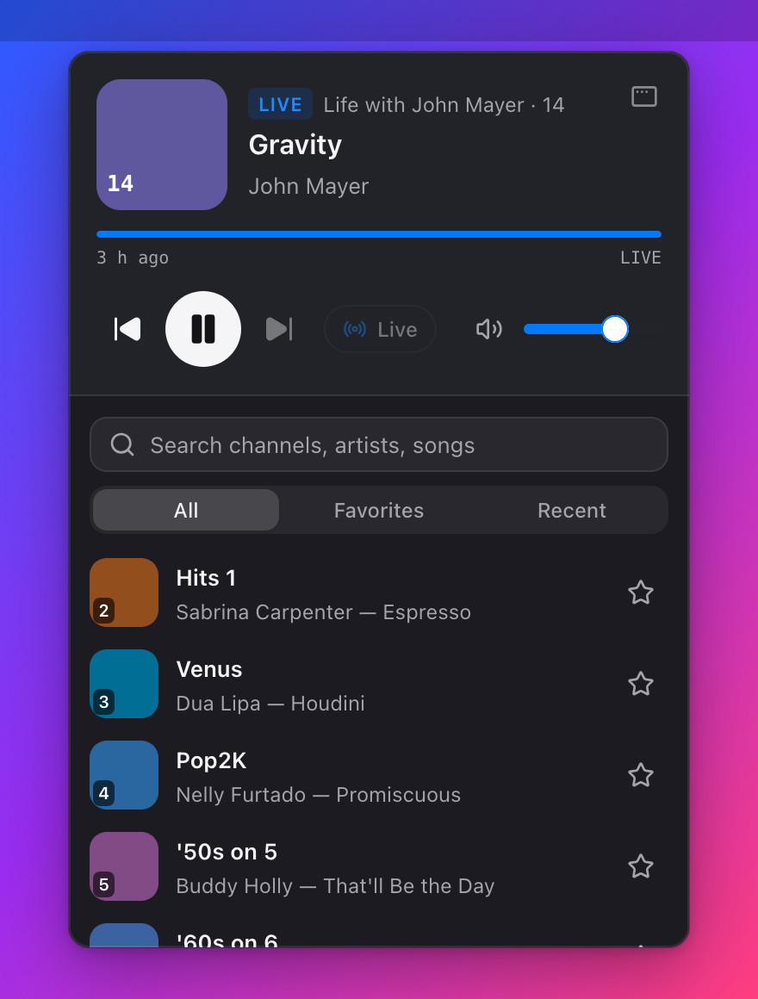
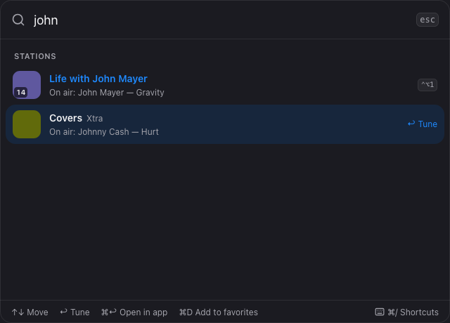
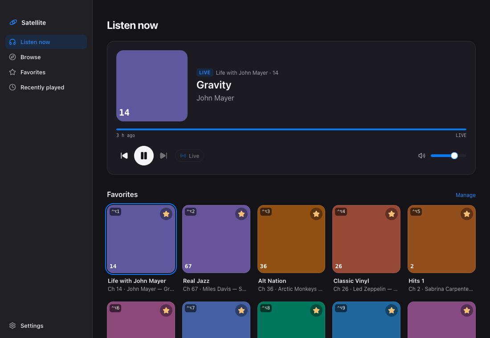
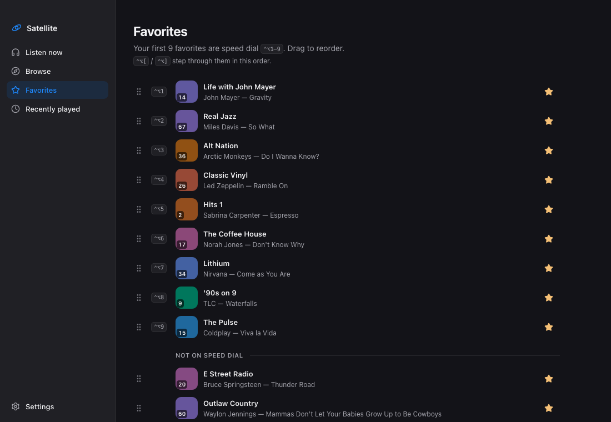

# Trever's Homebrew tap

## Satellite

[Satellite](https://www.trever.com/siriusxm-for-mac) is a menu bar and notch player for SiriusXM subscribers on macOS 14 or later. Unofficial: not affiliated with, endorsed by or sponsored by SiriusXM. You sign in with your own subscription.

```bash
brew install --cask trever/tap/satellite
```

Satellite updates itself (Sparkle), so `brew upgrade` skips it unless you pass `--greedy`.

### Screenshots

| Menu bar | Quick switcher |
|---|---|
|  |  |




